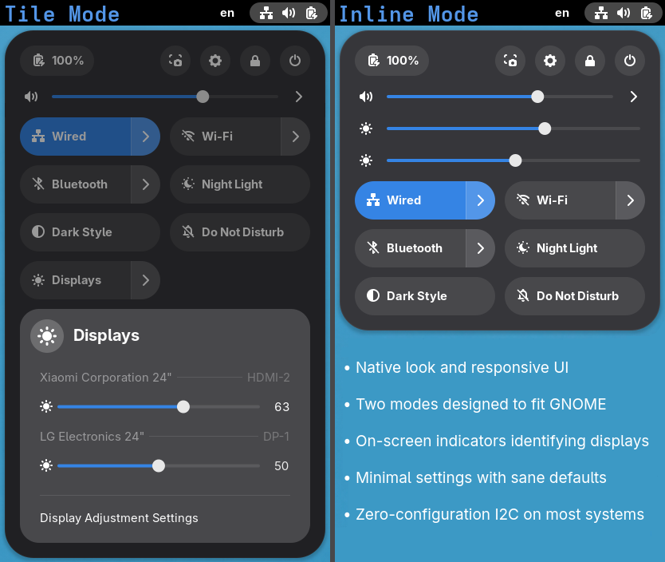

# Multi Display Adjustment GNOME shell extension

Offers sliders in Quick Settings to control the brightness and contrast of external displays through DDC/CI, one set per display, under the display name that Settings shows. Moving a slider shows the level in the on-screen display of the screens it adjusts, as GNOME does for a laptop's own screen.



## Installation

### 0. Dependencies

* GNOME 46-51
* [ddcutil-service](https://github.com/digitaltrails/ddcutil-service) (allows responsive communication with the displays compared to calling `ddcutil`)

### 1. Installation of ddcutil-service

* [**Arch Linux**](https://aur.archlinux.org/packages/ddcutil-service) — `yay -S ddcutil-service`
* [**openSUSE**](https://software.opensuse.org/package/ddcutil-service) — `sudo zypper install ddcutil-service`
* [**Debian 12 and 13, Ubuntu 24.04 to 26.04**](https://gitlab.com/w8jcik/ddcutil-service.deb#latest) — unofficial `amd64` packages by Maciej Wójcik:

  ```bash
  . /etc/os-release # Read distro-ver variables for next command. Equal to "source /etc/os-release".
  wget -O /tmp/ddcutil-service.deb "https://gitlab.com/api/v4/projects/w8jcik%2fddcutil-service.deb/packages/generic/${ID^}-${VERSION_ID}/1.0.14/ddcutil-service_1.0.14+${VERSION_CODENAME}-amd64.deb"
  sudo apt install /tmp/ddcutil-service.deb
  ```

  Other packages and instructions: [w8jcik/ddcutil-service.deb](https://gitlab.com/w8jcik/ddcutil-service.deb).

* **Fedora** — from the [COPR repository](https://copr.fedorainfracloud.org/coprs/hopsayer/ddcutil-service/):

  ```bash
  sudo dnf copr enable hopsayer/ddcutil-service
  sudo dnf install ddcutil-service
  ```

* **Any other** — [build it from source](./docs/installation.md#build-ddcutil-service-from-source)

Usually nothing else has to be set up for the displays to be reachable. If the sliders do not show
up, see [Access to the displays](./docs/installation.md#access-to-the-displays).

### 2. Installation of the extension

Install it from
[extensions.gnome.org](https://extensions.gnome.org/extension/10707/multi-display-adjustment/), in
the browser or with an app such as Extension Manager.

A new version shows up there once it passes review. To get the newest one before that, see
[Install from a release](./docs/installation.md#install-from-a-release).

## See more

### Using

* [Configuring](./docs/configuring.md)

### Troubleshooting

* [Diagnosing issues](./docs/troubleshooting.md#diagnosing-issues)
* [Known issues](./docs/troubleshooting.md#known-issues)

### Testing

* [Test plans](./docs/testing.md)
* [Run with mock displays](./docs/dev.md#mock-displays)

### Contributing

...is welcome:

* Feedback on [extensions.gnome.org](https://extensions.gnome.org/extension/10707/multi-display-adjustment/)
* Star this repo
* Issues
* Pull Requests

#### Thanks

* [@hopsayer](https://github.com/hopsayer), for the inline sliders and much of what came with them in 1.4.0.
* Everyone who reports an issue or tries a change on their own displays. See the [contributors](https://github.com/samuelcecilio/multi-display-adjustment/graphs/contributors) for everyone whose code is in here.

### Related projects

* [ddcutil](https://github.com/rockowitz/ddcutil) - fundamental backend.
* [ddcutil-service](https://github.com/digitaltrails/ddcutil-service) - D-Bus adaptation for OS integration and thus responsiveness.
* [w8jcik/display-adjustment](https://gitlab.com/w8jcik/display-adjustment) - GNOME extension which this project was [originally based on](./CHANGELOG.md#origin-2026-04-07).

## License

Distributed under GPL-2.0-or-later, see [LICENSING](./docs/LICENSING.md) and [LICENSE](./LICENSE).

---

_Like it? ⭐ Star this repo!_

<!--
[](https://github.com/samuelcecilio/multi-display-adjustment)
-->

<!--
[](https://star-history.com/#samuelcecilio/multi-display-adjustment&Date)


-->
